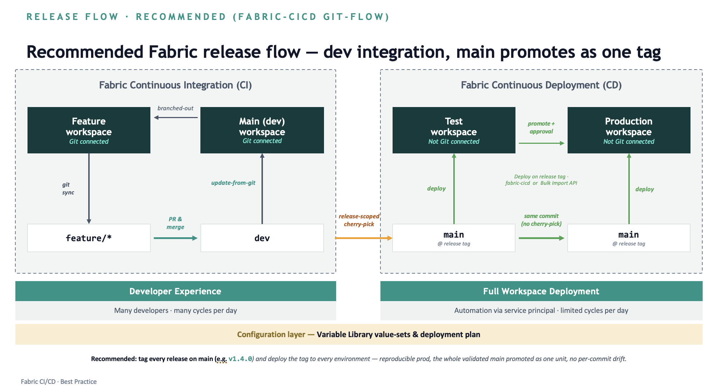

# Fabric CI/CD end to end with Terraform, fabric-cicd, and Azure DevOps Pipelines

Sample that takes a Microsoft Fabric project from an empty tenant to a tag-based release, using three Azure DevOps pipelines that all authenticate as a service principal:

| Stage | Folder | Pipeline | What it does |
|-------|--------|----------|--------------|
| 1. Infrastructure | `infra/` | Terraform: Plan, Approve, Apply | Capacity, workspaces `sales-analytics`, `test-sales-analytics`, `prod-sales-analytics`, and the Git connection of `sales-analytics` to the `sales-analytics/` folder |
| 2. Seed items | `items/` | Manual run | Creates demo items in `sales-analytics` with fabric-cicd: lakehouse, notebook, variable library, Direct Lake semantic model, paginated report |
| 3. Release | `release/` | Triggered by a tag on `main`: Validate, Test, Prod (approval) | Deploys the items committed in `sales-analytics/` to `test-sales-analytics`, then the same tag to `prod-sales-analytics`, with fabric-cicd bulk publish and dynamic replacement variables |

```
sales-analytics workspace --(commit from workspace)--> sales-analytics/ folder on main --(git tag v1.0.0)--> test-sales-analytics workspace --(approval)--> prod-sales-analytics workspace
```

## Recommended release flow



The flow separates developer integration (CI) from automated workspace deployment (CD):

**Continuous Integration (developer experience: many developers, many cycles per day)**

1. Developers branch out a **feature workspace** from the **main (dev) workspace**. Both are Git connected; the feature workspace syncs to a `feature/*` branch.
2. Changes are merged into `dev` with a pull request.
3. The main (dev) workspace runs **update from Git** to pick up the merged changes.

**Continuous Deployment (full workspace deployment: automation via service principal, limited cycles per day)**

1. A **release-scoped cherry-pick** moves the changes selected for the release from `dev` to `main`.
2. Every release is **tagged on `main`** (for example `v1.4.0`).
3. The tag is deployed with fabric-cicd (or the Bulk Import API) to the **test workspace**, which is not Git connected.
4. After approval, the **same commit** (no cherry-pick) is promoted to the **production workspace**, which is also not Git connected.

**Configuration layer:** Variable Library value sets and the deployment plan (here, `release/parameter.yml`) carry the per-environment differences.

Tagging every release on `main` and deploying that tag to every environment gives a reproducible production: the whole validated `main` is promoted as one unit, with no per-commit drift.

How this sample maps to the flow:

| Flow | This sample |
|------|-------------|
| Main (dev) workspace | `sales-analytics` (Git connected; set `ado_branch = "dev"` in `infra/terraform.tfvars` to follow the flow) |
| Test workspace | `test-sales-analytics`, deployed by the `Test` stage of `release/` on a tag on `main` |
| Production workspace | `prod-sales-analytics`, deployed by the `Prod` stage with the same tagged commit after the environment approval |
| Configuration layer | `vl_demo` variable library and `release/parameter.yml` |

## Repository layout

```
infra/
  azure-pipelines.yml   Pipeline definition (Plan / Approve / Apply)
  provider.tf           Providers (azurerm, fabric, time) and azurerm state backend
  variables.tf          Input variables
  main.tf               Capacity, workspaces, role assignment, Git connection
  outputs.tf            Capacity id and workspace ids
  terraform.tfvars      Environment settings: edit this
  backend.hcl           Terraform state location: edit this
items/
  azure-pipelines.yml   Seeds the demo items into sales-analytics (run once)
  deploy.py             fabric-cicd publish, runs the notebook, refreshes the model
  workspace/            Item definitions with placeholder IDs, plus parameter.yml
release/
  azure-pipelines.yml   Tag-triggered release: Validate, Test (test-sales-analytics), Prod (prod-sales-analytics)
  deploy-steps.yml      Deployment steps shared by the Test and Prod stages
  deploy.py             fabric-cicd bulk publish of sales-analytics/
  parameter.yml         Dynamic replacement variables (no hard-coded IDs)
sales-analytics/
                        Git folder of the sales-analytics workspace (filled by Fabric when you commit)
docs/                   Images used by this README
```

## What the infrastructure stage creates

1. A resource group and a **Fabric capacity** in Azure (the service principal is set as capacity admin).
2. Three workspaces on that capacity: `<name>`, `test-<name>`, and `prod-<name>`. The service principal creates them, so it is **Admin** on each.
3. A user added as **Contributor** on the main `<name>` workspace.
4. An Azure DevOps **source control connection** (service principal credentials) and a **Git connection** of the main workspace to a folder in an Azure DevOps repo.

The pipeline runs in three stages: **Plan**, **Approve** (manual), **Apply**. The plan is shown on the run Summary tab; the Apply stage applies exactly the reviewed plan. If the plan has no changes, Approve and Apply are skipped.

## Prerequisites

**Service principal** (app registration with a client secret):

- **Contributor** (or Owner) on the Azure subscription, to create the resource group and capacity, register the `Microsoft.Fabric` resource provider, and read the state storage account key.
- Added to the **Azure DevOps organization** with access to the target repository, so the Fabric Git connection can authenticate.

**Fabric tenant settings** (Fabric admin portal), enabled for the service principal or a security group that contains it:

- Service principals can use Fabric APIs.
- Service principals can create workspaces, connections, and deployment pipelines.
- Users can synchronize workspace items with their Git repositories.

**Azure:**

- Fabric capacity **quota** in the chosen region. Check it with:
  ```bash
  az rest --method get --url "https://management.azure.com/subscriptions/<subscription-id>/providers/Microsoft.Fabric/locations/<region>/usages?api-version=2023-11-01"
  ```
  A region with a limit of 0 fails with a regional quota error.
- An existing **storage account and container** for the Terraform state. The storage account must be reachable from the pipeline agent (Microsoft-hosted agents need public network access).

**Azure DevOps:**

- The target folder (`/sales-analytics`) exists in the repository and branch (this repository includes it).
- Microsoft-hosted agent parallelism (or change `pool` to a self-hosted pool).

## Setup

1. Copy this repository (all folders) into a repository in your Azure DevOps project.
2. Edit `infra/terraform.tfvars` with your region, names, contributor user object id, and Azure DevOps organization / project / repository / folder.
3. Edit `infra/backend.hcl` with the state storage resource group, account, container, and blob name.
4. Create a pipeline from `infra/azure-pipelines.yml` (Pipelines > New pipeline > Azure Repos Git > Existing YAML file).
5. In the pipeline, add a variable **`CLIENT_SECRET`**: mark it **secret** and **"Let users override this value when running this pipeline"**.

## Run

### 1. Infrastructure

1. Select **Run pipeline** and fill in the parameters: **Tenant ID**, **Service principal client ID**, **Azure subscription ID**. Set `CLIENT_SECRET` under Variables if it is not stored.
2. When the **Plan** stage finishes, review the plan on the run **Summary** tab.
3. On the **Approve** stage, select **Review**, then **Resume** to apply or **Reject** to stop. Pending approvals time out (reject) after 24 hours.

### 2. Seed the demo items

1. Create a pipeline from `items/azure-pipelines.yml` and add the secret variable **`CLIENT_SECRET`**.
2. Run it with **Tenant ID**, **Service principal client ID**, and **Target workspace name** (`sales-analytics`). It publishes the items, runs `nb_demo` to create `dbo.sales`, and refreshes `sm_demo`.
3. In the `sales-analytics` workspace, open **Source control** and **Commit** the new items. Fabric writes them to the `sales-analytics/` folder.

### 3. Release with a tag

1. Create a pipeline from `release/azure-pipelines.yml`. Add the variables **`TENANT_ID`**, **`CLIENT_ID`**, and secret **`CLIENT_SECRET`**, then **Save** the pipeline.
2. Create a tag on `main`, from Git (`git tag v1.0.0 && git push origin v1.0.0`) or in the portal (**Repos > Tags > New tag**).
3. The pipeline verifies the tag is on `main` and deploys `sales-analytics/` to `test-sales-analytics`. In `vl_demo`, `workspace_name` becomes `test-sales-analytics`.
4. The `Prod` stage waits for approval, then deploys the same commit to `prod-sales-analytics`.
5. In each target workspace, run `nb_demo` and refresh `sm_demo` so `rpt_demo` shows data.

The `Test` and `Prod` stages are deployment jobs that target the Azure DevOps environments `test-sales-analytics` and `prod-sales-analytics`. They are created on the first run; **Pipelines > Environments** then shows the deployment history of each workspace. To gate production, open the `prod-sales-analytics` environment, select **Approvals and checks**, and add an **Approvals** check. On the first run, Azure DevOps may ask you to **Permit** the pipeline to use each environment.

See `release/README.md` for the parameterization details.

## Notes

- **Bulk publish and paginated reports:** paginated reports do not yet support service principals for Git integration and the bulk import API (`PrincipalTypeNotSupported`). `release/deploy.py` therefore publishes `rpt_demo` in a second, standard pass. This is a temporary workaround; remove the second pass once paginated reports support it.
- **Renaming sales-analytics:** the name appears in `infra/terraform.tfvars` (`main_workspace_name`, `ado_directory`), the `sales-analytics/` folder, `release/parameter.yml` (`$workspace.sales-analytics...`), `release/deploy.py` (source folder), `release/azure-pipelines.yml` (`TARGET_WORKSPACE`), and the `vl_demo` default value in `items/`.
- **Feature branch flow:** if the workspace is connected to a branch other than `main` (for example `dev`), merge it to `main` with a pull request before tagging.
- **Experimental features:** bulk publish needs fabric-cicd 1.4.0 or later and the `enable_experimental_features` and `enable_bulk_publish` feature flags.

- **Secret in the plan artifact:** the plan file stores input variable values, including the client secret, in plain text. Anyone with read access to the pipeline artifacts can read it. For production use, restrict artifact access or pass credentials to the providers through environment variables instead of Terraform variables.
- **Workspace admin:** no explicit Admin role assignment is made for the service principal; the workspace creator is Admin automatically, and a duplicate assignment would fail.
- **Capacity lookup:** after creating the capacity, Terraform waits 60 seconds before looking it up in Fabric, so the new capacity is visible.
- **Changing region:** `location` changes force the resource group and capacity to be recreated.
